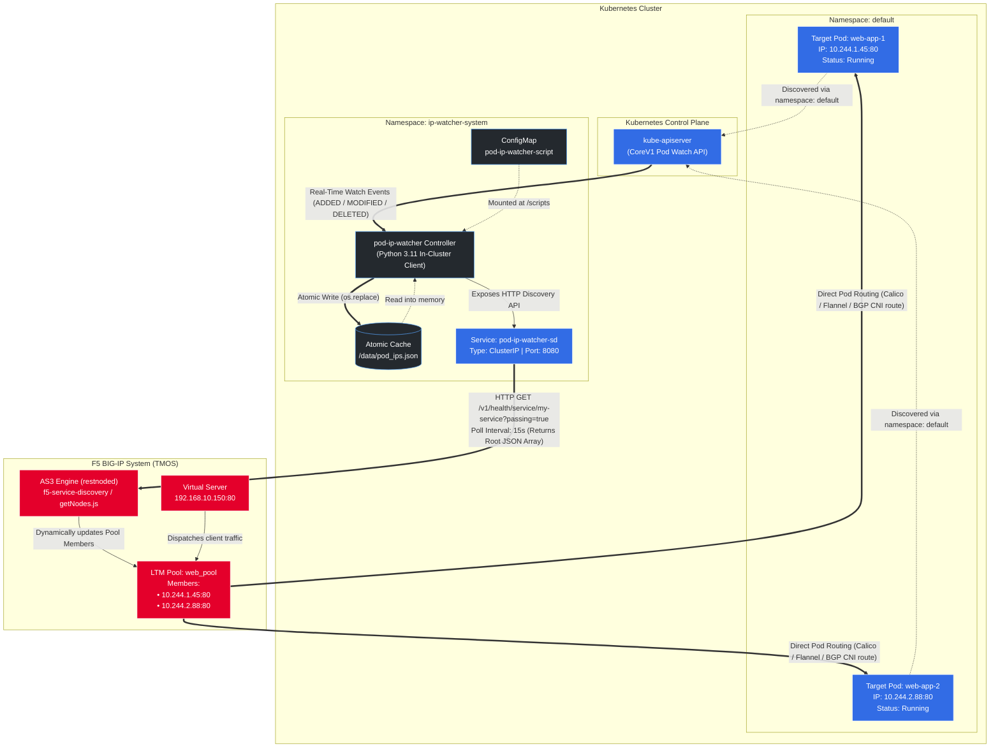

*Note: the links and images in this document may point to external sources. Please review them before opening.*

# Kubernetes Pod IP Watcher for F5 BIG-IP AS3 Service Discovery

[](https://kubernetes.io/)
[](https://clouddocs.f5.com/products/extensions/f5-appsvcs-extension/latest/)
[](https://www.python.org/)
[](LICENSE)

A lightweight, event-driven Kubernetes controller and HTTP service discovery endpoint tailored specifically for **F5 BIG-IP Application Services 3 (AS3)** dynamic service discovery (`consul` or `http` providers).

It continuously monitors Kubernetes Pod lifecycle events (`ADDED`, `MODIFIED`, `DELETED`) using the Kubernetes Watch API and serves an HTTP endpoint formatted specifically to satisfy F5's `f5-service-discovery: getNodes.js` parser without needing an external HashiCorp Consul cluster.

---

## Table of Contents

* [Architecture Diagram](#architecture-diagram)
* [Key Features](#key-features)
* [Repository Structure](#repository-structure)
* [Prerequisites](#prerequisites)
* [Quickstart & Deployment](#quickstart--deployment)
  * [1. All-in-One Kubernetes Manifest](#1-all-in-one-kubernetes-manifest)
  * [2. Deploy to Cluster](#2-deploy-to-cluster)
  * [3. Verify Service Discovery Output](#3-verify-service-discovery-output)
* [F5 BIG-IP AS3 Declaration](#f5-big-ip-as3-declaration)
* [Configuration Options](#configuration-options)
* [Troubleshooting & Diagnostics](#troubleshooting--diagnostics)
* [License](#license)

---

## Architecture Diagram



---

## Key Features

* **Strict AS3 Schema Compatibility**: Returns a root-level JSON Array (`[ { ... } ]`) on `/v1/health/service/<sd_service_name>?passing=true` to satisfy `Array.isArray()` checks in `f5-service-discovery: getNodes.js`.
* **Zero External Dependencies**: Simulates HashiCorp Consul's health-check service discovery endpoint directly from Kubernetes pod status without deploying or maintaining a Consul cluster.
* **Event-Driven & Low Resource Footprint**: Uses Kubernetes streaming `watch` connections instead of periodic polling loops, minimizing API server and cluster load.
* **Atomic Zero-Downtime Reads**: Updates the cached state file using `os.replace` on temporary files to ensure BIG-IP never encounters locked or partially written JSON.
* **Least-Privilege Security**: Bound via a namespace-scoped `Role` and `RoleBinding` restricted strictly to `get`, `list`, and `watch` permissions within the monitored namespace.

---

## Repository Structure

```text
.
├── README.md
├── manifests/
│   └── all-in-one.yaml        # Complete namespace, RBAC, ConfigMap, Deployment, and Service
├── as3/
│   └── as3-declaration.json  # Reference F5 AS3 declaration using Consul Service Discovery
└── src/
    ├── Dockerfile            # Container buildfile for air-gapped environments
    ├── requirements.txt      # Python dependencies
    └── pod_ip_watcher.py     # Standalone Python controller and HTTP server
```

---

## Prerequisites

* **Kubernetes Cluster**: v1.24+ (Worker nodes must route to BIG-IP or share CNI overlay routes).
* **F5 BIG-IP**: TMOS v14.1+ with **AS3 v3.40+** installed.
* **Network Connectivity**: BIG-IP must be able to reach the Service `ClusterIP` or `NodePort` on port `8080`.

---

## Quickstart & Deployment

### 1. All-in-One Kubernetes Manifest

Save the following YAML as `manifests/all-in-one.yaml`:

```yaml
apiVersion: v1
kind: Namespace
metadata:
  name: ip-watcher-system
---
apiVersion: v1
kind: ServiceAccount
metadata:
  name: pod-ip-watcher-sa
  namespace: ip-watcher-system
---
apiVersion: rbac.authorization.k8s.io/v1
kind: Role
metadata:
  name: pod-ip-watcher-role
  namespace: default
rules:
  - apiGroups: [""]
    resources: ["pods"]
    verbs: ["get", "list", "watch"]
---
apiVersion: rbac.authorization.k8s.io/v1
kind: RoleBinding
metadata:
  name: pod-ip-watcher-binding
  namespace: default
subjects:
  - kind: ServiceAccount
    name: pod-ip-watcher-sa
    namespace: ip-watcher-system
roleRef:
  kind: Role
  name: pod-ip-watcher-role
  apiGroup: rbac.authorization.k8s.io
---
apiVersion: v1
kind: ConfigMap
metadata:
  name: pod-ip-watcher-script
  namespace: ip-watcher-system
data:
  pod_ip_watcher.py: |
    import json
    import os
    import time
    import signal
    import logging
    from datetime import datetime, timezone
    from http.server import HTTPServer, BaseHTTPRequestHandler
    import threading
    from kubernetes import client, config, watch
    from kubernetes.client.rest import ApiException

    logging.basicConfig(level=logging.INFO, format="%(asctime)s - %(levelname)s - %(message)s")

    stop_requested = False
    output_path = os.getenv("OUTPUT_FILE_PATH", "/data/pod_ips.json")
    http_port = int(os.getenv("HTTP_PORT", "8080"))
    sd_service_name = os.getenv("SD_SERVICE_NAME", "my-service")

    def handle_signal(signum, frame):
        global stop_requested
        logging.info(f"Signal {signum} received, stopping...")
        stop_requested = True

    signal.signal(signal.SIGTERM, handle_signal)
    signal.signal(signal.SIGINT, handle_signal)

    def load_k8s_config():
        try:
            config.load_incluster_config()
            logging.info("Loaded in-cluster Kubernetes configuration.")
        except config.ConfigException:
            config.load_kube_config()
            logging.info("Loaded local kubeconfig configuration.")

    def extract_pod_info(pod):
        if not pod.status or not pod.status.pod_ip:
            return None
        pod_ip = pod.status.pod_ip
        return {
            "id": pod.metadata.name,
            "name": pod.metadata.name,
            "namespace": pod.metadata.namespace,
            "pod_ip": pod_ip,
            "ip": {
                "private": pod_ip,
                "public": pod_ip
            },
            "host_ip": pod.status.host_ip,
            "phase": pod.status.phase,
            "node_name": pod.spec.node_name,
            "labels": pod.metadata.labels or {}
        }

    def write_json_atomically(pods_state, path):
        os.makedirs(os.path.dirname(path), exist_ok=True)
        temp_path = f"{path}.tmp"
        payload = list(pods_state.values())
        with open(temp_path, "w", encoding="utf-8") as f:
            json.dump(payload, f, indent=2)
        os.replace(temp_path, path)
        logging.info(f"Wrote {len(payload)} pods to {path}")

    class DiscoveryHandler(BaseHTTPRequestHandler):
        def do_GET(self):
            expected_prefix = f"/v1/health/service/{sd_service_name}"
            if self.path == "/" or self.path.startswith(expected_prefix) or self.path == "/pods":
                self.send_response(200)
                self.send_header("Content-Type", "application/json")
                self.end_headers()
                if os.path.exists(output_path):
                    with open(output_path, "rb") as f:
                        self.wfile.write(f.read())
                else:
                    self.wfile.write(b"[]\n")
            elif self.path == "/healthz":
                self.send_response(200)
                self.send_header("Content-Type", "text/plain")
                self.end_headers()
                self.wfile.write(b"OK\n")
            else:
                self.send_response(404)
                self.end_headers()

        def log_message(self, format, *args):
            return

    def run_http_server():
        server = HTTPServer(("0.0.0.0", http_port), DiscoveryHandler)
        logging.info(f"HTTP Discovery server listening on 0.0.0.0:{http_port}")
        while not stop_requested:
            server.handle_request()
        server.server_close()

    def watch_pods():
        load_k8s_config()
        v1 = client.CoreV1Api()
        pods_state = {}

        while not stop_requested:
            try:
                logging.info("Listing pods in namespace 'default'...")
                pod_list = v1.list_namespaced_pod(namespace="default")
                pods_state.clear()
                for pod in pod_list.items:
                    info = extract_pod_info(pod)
                    if info:
                        pods_state[pod.metadata.name] = info

                write_json_atomically(pods_state, output_path)
                resource_version = pod_list.metadata.resource_version

                w = watch.Watch()
                logging.info(f"Watching pod stream from resourceVersion={resource_version}...")
                for event in w.stream(v1.list_namespaced_pod, namespace="default", resource_version=resource_version, timeout_seconds=300):
                    if stop_requested:
                        w.stop()
                        break
                    pod = event["object"]
                    key = pod.metadata.name
                    ev_type = event["type"]
                    changed = False

                    if ev_type in ("ADDED", "MODIFIED"):
                        info = extract_pod_info(pod)
                        if info:
                            if pods_state.get(key) != info:
                                pods_state[key] = info
                                changed = True
                        elif key in pods_state:
                            del pods_state[key]
                            changed = True
                    elif ev_type == "DELETED" and key in pods_state:
                        del pods_state[key]
                        changed = True

                    if changed:
                        write_json_atomically(pods_state, output_path)

            except ApiException as e:
                if e.status == 410:
                    logging.warning("ResourceVersion expired (410 Gone). Re-syncing...")
                else:
                    logging.error(f"K8s API error: {e}. Retrying in 5s...")
                    time.sleep(5)
            except Exception as e:
                logging.error(f"Unexpected watcher error: {e}. Retrying in 5s...")
                time.sleep(5)

    if __name__ == "__main__":
        http_thread = threading.Thread(target=run_http_server, daemon=True)
        http_thread.start()
        watch_pods()
---
apiVersion: apps/v1
kind: Deployment
metadata:
  name: pod-ip-watcher
  namespace: ip-watcher-system
spec:
  replicas: 1
  selector:
    matchLabels:
      app: pod-ip-watcher
  template:
    metadata:
      labels:
        app: pod-ip-watcher
    spec:
      serviceAccountName: pod-ip-watcher-sa
      initContainers:
        - name: install-deps
          image: python:3.11-slim
          command: ["sh", "-c", "echo 'Installing kubernetes client...'; pip install --no-cache-dir --target=/pip-packages kubernetes>=29.0.0 && echo 'Dependencies installed.'"]
          volumeMounts:
            - name: pip-lib
              mountPath: /pip-packages
      containers:
        - name: watcher
          image: python:3.11-slim
          command: ["python", "-u", "/scripts/pod_ip_watcher.py"]
          env:
            - name: PYTHONUNBUFFERED
              value: "1"
            - name: PYTHONPATH
              value: "/pip-packages"
            - name: TARGET_NAMESPACE
              value: "default"
            - name: SD_SERVICE_NAME
              value: "my-service"
            - name: HTTP_PORT
              value: "8080"
            - name: OUTPUT_FILE_PATH
              value: "/data/pod_ips.json"
          volumeMounts:
            - name: script-vol
              mountPath: /scripts
            - name: pip-lib
              mountPath: /pip-packages
            - name: shared-data
              mountPath: /data
          ports:
            - name: http
              containerPort: 8080
          resources:
            requests:
              cpu: 50m
              memory: 64Mi
            limits:
              cpu: 250m
              memory: 128Mi
          readinessProbe:
            httpGet:
              path: /healthz
              port: 8080
            initialDelaySeconds: 5
            periodSeconds: 10
      volumes:
        - name: script-vol
          configMap:
            name: pod-ip-watcher-script
        - name: pip-lib
          emptyDir: {}
        - name: shared-data
          emptyDir: {}
---
apiVersion: v1
kind: Service
metadata:
  name: pod-ip-watcher-sd
  namespace: ip-watcher-system
spec:
  type: ClusterIP
  selector:
    app: pod-ip-watcher
  ports:
    - name: http
      port: 8080
      targetPort: 8080
```

### 2. Deploy to Cluster

```bash
kubectl apply -f manifests/all-in-one.yaml
```

Monitor rollout until ready:

```bash
kubectl rollout status deployment/pod-ip-watcher -n ip-watcher-system
```

### 3. Verify Service Discovery Output

Run a non-interactive curl container to verify the JSON output:

```bash
kubectl run curl-test --rm -i --restart=Never --image=curlimages/curl -n default -- \
  curl -s http://pod-ip-watcher-sd.ip-watcher-system.svc.cluster.local:8080/v1/health/service/my-service?passing=true
```

Expected JSON Array output:

```json
[
  {
    "id": "nginx-demo-7bf66bd59-a1b2c",
    "name": "nginx-demo-7bf66bd59-a1b2c",
    "namespace": "default",
    "pod_ip": "10.244.1.45",
    "ip": {
      "private": "10.244.1.45",
      "public": "10.244.1.45"
    },
    "host_ip": "192.168.1.101",
    "phase": "Running",
    "node_name": "worker-node-1",
    "labels": {
      "app": "nginx-demo"
    }
  }
]
```

---

## F5 BIG-IP AS3 Declaration

Post the following declaration to your BIG-IP AS3 endpoint (`POST https://<BIG-IP-IP>/mgmt/shared/appsvcs/declare`):

```json
{
  "class": "AS3",
  "action": "deploy",
  "persist": true,
  "declaration": {
    "class": "ADC",
    "schemaVersion": "3.45.0",
    "id": "k8s-pod-discovery",
    "HTTP_SD_Tenant": {
      "class": "Tenant",
      "Sample_App": {
        "class": "Application",
        "template": "generic",
        "serviceMain": {
          "class": "Service_HTTP",
          "virtualAddresses": [
            "192.168.10.150"
          ],
          "pool": "web_pool"
        },
        "web_pool": {
          "class": "Pool",
          "monitors": [
            "http"
          ],
          "members": [
            {
              "servicePort": 80,
              "addressDiscovery": "consul",
              "updateInterval": 15,
              "uri": "http://pod-ip-watcher-sd.ip-watcher-system.svc.cluster.local:8080/v1/health/service/my-service?passing=true",
              "jmesPathQuery": "[*].{id: id, ip: ip}"
            }
          ]
        }
      }
    }
  }
}
```

---

## Configuration Options

The following environment variables can be adjusted on the `watcher` container:

| Variable | Default Value | Description |
| :--- | :--- | :--- |
| `TARGET_NAMESPACE` | `default` | Kubernetes namespace to monitor for Pods. |
| `SD_SERVICE_NAME` | `my-service` | Service name in the discovery URI path (`/v1/health/service/<SD_SERVICE_NAME>`). |
| `HTTP_PORT` | `8080` | Port for the embedded discovery HTTP server. |
| `OUTPUT_FILE_PATH` | `/data/pod_ips.json` | Path on disk where the serialized Pod state is written. |
| `PYTHONUNBUFFERED` | `1` | Forces unbuffered stdout/stderr output for instant `kubectl logs`. |

---

## Troubleshooting & Diagnostics

### 1. `severe: [f5-service-discovery: getNodes.js] error: Data must be a JSON array of objects`

* **Root Cause**: AS3's discovery parser requires the query result to evaluate to a JavaScript array (`Array.isArray() === true`).
* **Verification**: Run `curl -s <uri>` from BIG-IP. If the output starts with `{` rather than `[`, update the Python controller to the current version in this repository.
* **JMESPath**: Ensure your AS3 declaration uses `"jmesPathQuery": "[*].{id: id, ip: ip}"`.

### 2. Discovered Nodes Not Showing in BIG-IP LTM Pool

* **Check AS3 Logs on BIG-IP**:
  ```bash
  tail -f /var/log/restnoded/restnoded.log | grep -E "getNodes|Task|HTTP_SD_Tenant"
  ```
* **Verify HTTP Connectivity from BIG-IP**:
  ```bash
  curl -I http://pod-ip-watcher-sd.ip-watcher-system.svc.cluster.local:8080/v1/health/service/my-service?passing=true
  ```
* **DNS Resolution Check**: If BIG-IP cannot resolve `svc.cluster.local`, either:
  * Add Kubernetes CoreDNS to BIG-IP's DNS resolvers (`tmsh modify sys dns name-servers add { <CoreDNS-ClusterIP> }`), or
  * Replace the hostname in the AS3 `uri` with the Service's ClusterIP directly.

### 3. Check Script Ingestion inside ConfigMap

```bash
# Verify the script in ConfigMap is complete and un-truncated
kubectl get configmap pod-ip-watcher-script -n ip-watcher-system -o jsonpath='{.data.pod_ip_watcher\.py}' | wc -l

# Check compilation inside the running container
kubectl exec -it -n ip-watcher-system deploy/pod-ip-watcher -c watcher -- python3 -m py_compile /scripts/pod_ip_watcher.py
```

---

## License

This project is licensed under the Apache 2.0 License. See the [LICENSE](LICENSE) file for details.